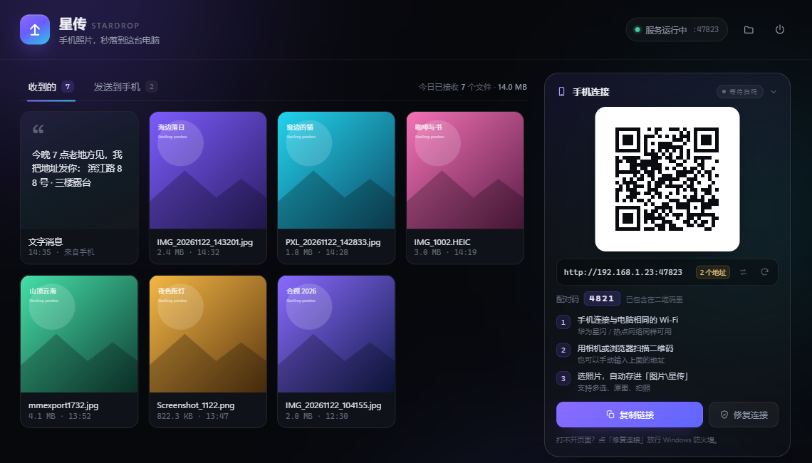
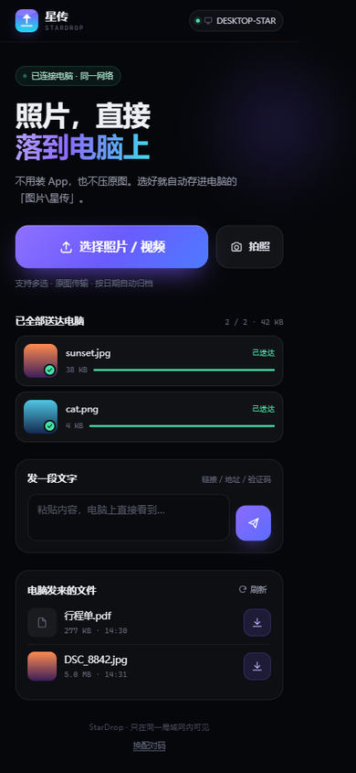

# 星传 StarDrop

> 手机照片，秒落到电脑上。扫码即传，手机零安装。
>
> Phone → PC photo transfer over Wi-Fi. Scan a QR code, pick photos, done. No phone app required.


## 为什么是浏览器页面，而不是星闪 App

华为星闪（NearLink）的文件互传属于华为生态内的私有能力，**Windows 侧没有面向第三方应用的公开文件传输 SDK / API**。做原生星闪 App 只能覆盖华为手机，还要鸿蒙原生开发与签名，成本高、覆盖面窄。

星传选择「同一局域网 + 手机浏览器页面」：

- iPhone / 安卓 / 鸿蒙通吃，手机**不用装 App**
- 原图直传，不经过任何云服务
- 电脑端一个 Tauri 桌面应用，手机端就是一个二维码
- 如果电脑的星闪以网络适配器形式出现（或手机开热点、USB 网络共享），页面同样直接走那个网络，代码不用改

## 截图

| 桌面端 | 手机端 |
| --- | --- |
|  |  |

手机连上后，二维码面板会自动收起，只保留“手机连接 · 已连接”一行；点击标题可重新展开，手机断开约 25 秒后自动恢复展开。

## 功能

- 手机扫码 → 选择照片 / 视频 / 拍照，支持多选、上传进度、原图
- 电脑拖文件进窗口 → 手机页面底部下载；也可以点“选择文件”
- 手机发文字 / 链接 → 桌面文字卡片，一键复制
- 大图预览，支持打开、在资源管理器中定位、复制路径
- 收图自动按日期归档：`图片\星传\YYYY-MM-DD\`
- 重名自动加序号，中文 / 空格文件名正常
- **配对码与端口持久化**，重启应用 / 电脑后不用重新扫码
- 手机在线时二维码面板自动收起，断开 25 秒后自动展开
- 单实例运行，重复双击只聚焦已有窗口
- 一键“修复连接”放行 Windows 防火墙

## 快速开始

### 下载

到 [Releases](https://github.com/so2bin/stardrop/releases/latest) 下载 `StarDrop-<version>-win-x64.zip`，解压后双击 `StarDrop.exe`。

> Windows 可能提示“未知发布者”，这是未签名的开源程序，选择“更多信息 → 仍要运行”即可。
> 首次启动如果弹出防火墙提示，请勾选专用/公用网络并允许，否则手机无法访问。

### 使用

1. 手机连上与电脑相同的 Wi‑Fi（星闪网络、热点也行）
2. 用手机相机 / 浏览器扫描窗口右侧二维码
3. 选照片，自动保存到 `C:\Users\<你>\Pictures\星传\<日期>\`
4. 电脑要发文件给手机：把文件拖进窗口，手机页面底部点下载

电脑上的配对码和端口保存在：

```
%LOCALAPPDATA%\StarDrop\config.json
```

形如 `{"pin":"1234","port":47823}`。想换配对码或端口，关闭应用后修改此文件再启动。

## 构建

### 依赖

- Windows 10/11 + WebView2 Runtime（Win11 自带）
- Rust 1.90+
- MSVC 工具链（推荐）或 MinGW-w64 GNU 工具链（本项目在 GNU 下也验证过）

### 编译

```powershell
cargo build --release --manifest-path src-tauri/Cargo.toml
```

产物在 `src-tauri/target/release/stardrop.exe`。

- **MSVC 工具链**：WebView2Loader 静态链接，单个 exe 即可运行
- **MinGW-w64 GNU 工具链**：同目录会生成 `WebView2Loader.dll`，运行时必须和 exe 放在一起，否则会报 `0xC0000135`

`scripts/package.ps1` 会自动处理：存在 `WebView2Loader.dll` 就一起打进 zip，不存在则跳过。

### 打包

```powershell
pwsh scripts/package.ps1
```

生成 `dist/StarDrop-<version>-win-x64.zip`，内含 exe、图标、使用说明和卸载脚本；GNU 构建会额外包含 `WebView2Loader.dll`。

### 开发说明

前端是原生 HTML/CSS/JS，没有打包器。`ui/` 下的资源在编译期通过 `include_str!` 内嵌进 exe，所以**改完 UI 需要重新 `cargo build`**，不存在热更新。

## 项目结构

```
ui/
  index.html / styles.css / app.js     桌面端界面
  mobile.html / mobile.css / mobile.js 手机端页面（由本地服务在 / 提供）
  qr.js                               二维码生成（byte mode / EC M）
src-tauri/
  src/main.rs                         Tauri 命令、单实例、DPI、WebView2 数据目录
  src/model.rs                        状态、配置持久化、配对码/端口
  src/server.rs                       HTTP 服务、上传/下载/缩略图
  src/util.rs                         时间、文件名、IP、编码
  app.manifest                        PerMonitorV2 DPI 感知
  tauri.conf.json
install/                              安装附带的使用说明与卸载脚本
scripts/                              构建 / 打包脚本
```

## 实现要点

- **HTTP 服务**：`std::net::TcpListener` + 每连接一个线程，手写请求解析、chunked 解码、流式落盘；不依赖 axum/hyper，二进制更小。
- **手机端**：单页 H5，XHR 上传进度、3 并发、失败提示；页面每 5 秒轮询待下载列表，同时作为在线心跳。
- **二维码**：`ui/qr.js` 自实现 QR（byte mode / EC level M / version 1–6），已用 OpenCV 解码验证。
- **缩略图**：`image` crate 解码后生成 520px JPEG，内存缓存。
- **在线状态**：只有手机侧接口（上传 / 文字 / 拉取 outbox）刷新 `last_seen`；桌面自己加载缩略图不会误判。
- **DPI**：自带 `app.manifest` 声明 PerMonitorV2，200% 缩放下窗口不会溢出屏幕。
- **端口**：优先配置端口 → 47823–47852 → 系统临时端口，成功绑定后写回配置。

## HTTP 接口

| 方法 | 路径 | 说明 |
| --- | --- | --- |
| GET | `/`、`/m.css`、`/m.js` | 手机端页面 |
| GET | `/api/info` | 设备名（无需配对码） |
| GET | `/api/outbox?k=` | 手机拉取待下载列表（同时作为心跳） |
| POST | `/api/upload?name=` | 手机上传，原始 body 流式落盘 |
| POST | `/api/text` | 手机发文字 |
| POST | `/api/outbox?name=` | 桌面浏览器选文件后写入待发送 |
| GET | `/thumb?id=&k=` | 缩略图 |
| GET | `/file?id=&k=` | 原图 / 视频内联 |
| GET | `/download?id=&k=` | 附件下载（RFC 5987 中文文件名） |

配对码校验：query 参数 `k` 或请求头 `X-Key`。

## 安全说明

- 服务只监听局域网，照片不经过任何服务器
- 配对码在二维码 URL 中，相当于一次性的局域网口令；请勿把端口转发到公网
- 明文 HTTP，仅建议在可信家庭 / 办公网络使用
- 收到的文件会直接写入磁盘，请只让自己信任的设备扫码

## 已知限制

- 仅 Windows（Tauri 也可以移植到 macOS / Linux，但 WebView2 相关逻辑需要调整）
- HEIC 预览依赖系统解码器，解码失败时显示扩展名占位图，文件仍会正常保存
- 手机浏览器必须与电脑网络互通；访客 Wi‑Fi / AP 隔离会导致打不开
- 没有做断点续传，超大视频建议在稳定 Wi‑Fi 下传输

## License

[MIT](LICENSE) © 2026 heli (so2bin)
